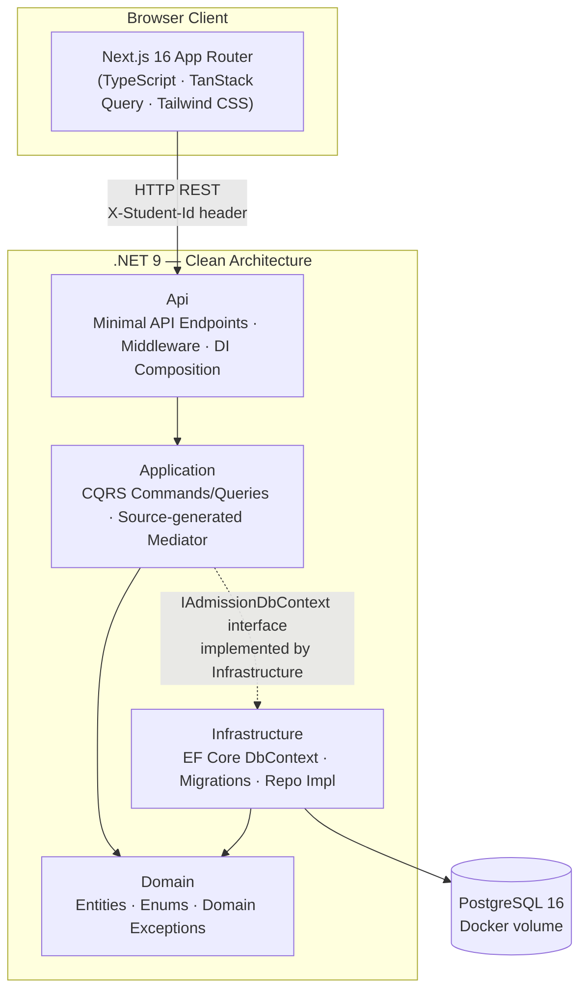
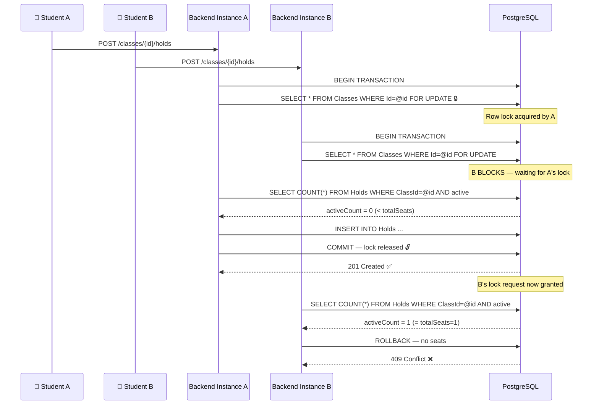
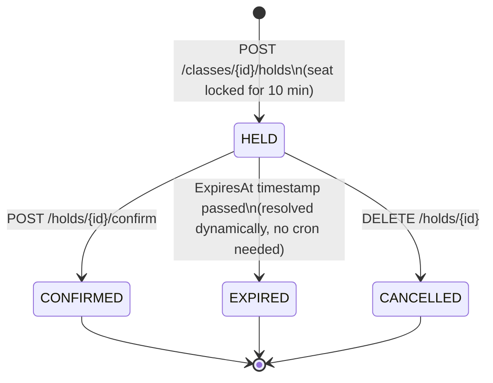
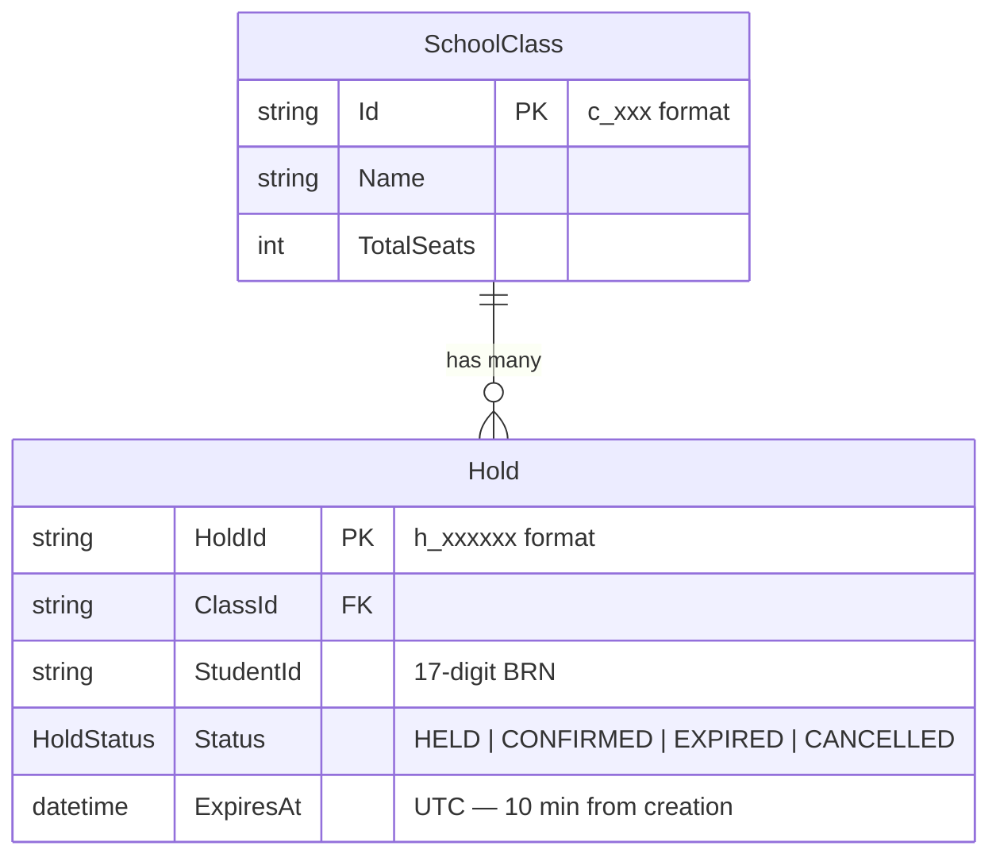

<div align="center">

# 🎓 SchoolAdmit

**A high-concurrency, first-come-first-served online school admission platform engineered for race-condition safety at scale.**

[](https://nextjs.org)
[](https://react.dev)
[](https://dotnet.microsoft.com)
[](https://learn.microsoft.com/en-us/dotnet/csharp/)
[](https://www.typescriptlang.org)
[](https://www.postgresql.org)
[](https://www.docker.com)

[](https://github.com/engrAntor/School-Registration-System/stargazers)
[](https://github.com/engrAntor/School-Registration-System/network/members)
[](https://github.com/engrAntor/School-Registration-System/commits/main)

</div>

<p align="center">
  <a href="#-overview">Overview</a> •
  <a href="#-highlights">Highlights</a> •
  <a href="#-architecture">Architecture</a> •
  <a href="#-concurrency-strategy">Concurrency</a> •
  <a href="#-api-reference">API Reference</a> •
  <a href="#-tech-stack">Tech Stack</a> •
  <a href="#-project-structure">Structure</a> •
  <a href="#-getting-started">Getting Started</a> •
  <a href="#-testing">Testing</a>
</p>

---

## 📖 Overview

**SchoolAdmit** is a production-grade, full-stack school admission system where students race to secure seats in limited-capacity classes — and the system guarantees that **no seat is ever double-booked**, even under hundreds of simultaneous requests hitting multiple backend instances.

The backend is a **.NET 9 Minimal API** built on **Clean Architecture** with **CQRS via source-generated Mediator**. The frontend is a **Next.js 16 App Router** application with real-time seat polling and live countdown timers. Everything runs in Docker with a single command.

> **The core engineering challenge:** When 100 students simultaneously apply for the last remaining seat, exactly 1 must succeed and 99 must receive a `409 Conflict`. This is proven by an automated high-stress concurrency test included in the test suite.

---

## 🌟 Highlights

| | |
|---|---|
| ⚡ **Race-condition proof** | `SELECT ... FOR UPDATE` pessimistic locking + partial unique index — mathematically safe across any number of distributed backend instances |
| 🏗️ **Clean Architecture** | Domain → Application → Infrastructure → API, with zero framework leakage into business logic |
| 📡 **CQRS** | Source-generated `Mediator` (zero reflection), commands and queries fully decoupled |
| ⏱️ **Live UI** | Seat counts auto-refresh every 5 seconds; hold countdown auto-expires at zero — no page reload needed |
| 🧪 **27 automated tests** | 6 xUnit integration tests (incl. 100-concurrent-request stress test) + 21 Jest/Testing Library unit tests, all passing |
| 🐳 **One-command Docker** | `docker compose up --build` — PostgreSQL + Backend + Frontend — no other dependencies |
| 🔥 **k6 load tested** | 4,646 requests, p95 ≤ 46ms, 0 failures under sustained load |

---

## 🏛 Architecture

The backend enforces a strict **dependency inversion** boundary: outer rings depend inward, never the reverse.



**Dependency rule in practice:**
- **`Domain`** — pure C# entities (`SchoolClass`, `Hold`), enums (`HoldStatus`), and `DomainException`. Zero framework dependencies.
- **`Application`** — `CreateHoldCommand` + `CreateHoldCommandHandler` orchestrate the seat-hold business logic via `IAdmissionDbContext`. Depends only on Domain.
- **`Infrastructure`** — `AdmissionDbContext` (EF Core), migrations, and `HoldSeatSafelyAsync` with PostgreSQL-level locking. Implements Application interfaces.
- **`Api`** — Minimal API endpoints, the `X-Student-Id` header validation middleware, global exception handler, and the DI composition root.

---

## 🔒 Concurrency Strategy

> This is the most technically demanding aspect of the system. Two complementary database-enforced layers guarantee correctness with **zero race window** regardless of how many backend instances are running.

### The Problem: Time-of-Check to Time-of-Use (TOCTOU)

```
Instance A reads available seats = 1
Instance B reads available seats = 1   ← same snapshot
Instance A inserts hold → seats = 0
Instance B inserts hold → seats = -1   ← OVERSELL 🔴
```

A naive `CountAsync()` check without a lock cannot prevent this in a multi-process environment.

### Tier 1 — Pessimistic Row-Level Locking (`SELECT … FOR UPDATE`)



### Tier 2 — Partial Unique Index (Student Invariant)

A schema-level guard prevents one student from ever holding two seats in the same class — even if application logic is bypassed:

```csharp
modelBuilder.Entity<Hold>()
    .HasIndex(h => new { h.StudentId, h.ClassId })
    .IsUnique()
    .HasFilter("\"Status\" IN (0, 1)"); // 0=HELD, 1=CONFIRMED
```

PostgreSQL rejects duplicate insertions with a unique constraint violation, which the backend translates to `409 Conflict`.

**Mathematical guarantee:** `(held + confirmed) ≤ totalSeats` — always, across any topology.

---

## 🔄 Seat Hold Lifecycle



> **No background job required.** Expiry is resolved dynamically at query time by comparing `ExpiresAt` to `UTC now`. Expired holds automatically free their seats for the next student.

---

## 📡 API Reference

All student-facing endpoints require the `X-Student-Id` header containing a valid **17-digit Birth Registration Number (BRN)**. Class management endpoints are public.

### Classes

| Method | Endpoint | Auth | Description |
|--------|----------|------|-------------|
| `GET` | `/classes` | — | List all classes with live seat counts |
| `GET` | `/classes/{classId}` | — | Get a single class with seat breakdown |
| `POST` | `/classes` | — | Create a new class (admin) |

**POST `/classes` body:**
```json
{ "name": "Class 6 Morning Shift", "totalSeats": 120 }
```

**GET `/classes` response:**
```json
[
  {
    "id": "c_a3f",
    "name": "Class 6 Morning Shift",
    "totalSeats": 120,
    "confirmedSeats": 2,
    "heldSeats": 0,
    "availableSeats": 118
  }
]
```

### Holds (Seat Applications)

> All endpoints below require: `X-Student-Id: <17-digit-BRN>`

| Method | Endpoint | Description |
|--------|----------|-------------|
| `POST` | `/classes/{classId}/holds` | Apply for a seat (creates a 10-min hold) |
| `GET` | `/holds/{holdId}` | Get hold status and expiry |
| `POST` | `/holds/{holdId}/confirm` | Confirm and lock in the admission |
| `DELETE` | `/holds/{holdId}` | Cancel an active hold |
| `GET` | `/me/holds` | List all my applications |

**POST `/classes/{classId}/holds` → 201 Created:**
```json
{
  "holdId": "h_84f221",
  "classId": "c_a3f",
  "studentId": "05008800800090001",
  "status": "HELD",
  "expiresAt": "2026-11-11T22:14:13Z"
}
```

**Error responses:**

| Status | Scenario |
|--------|----------|
| `400` | Missing or malformed `X-Student-Id` header |
| `404` | Class or hold not found |
| `409` | No seats available, or student already has an active hold for this class |

---

## 🛠 Tech Stack

### Frontend — `frontend/`

| Layer | Technology |
|-------|-----------|
| Framework | Next.js 16.4 (App Router), React 19 |
| Language | TypeScript |
| Styling | Tailwind CSS v3, shadcn/ui |
| State & Fetching | TanStack Query v5 (auto-polling, optimistic updates) |
| Notifications | Sonner toast notifications |
| Icons | Lucide React |
| Testing | Jest + ts-jest + Testing Library (21 tests) |

### Backend — `backend/`

| Layer | Technology |
|-------|-----------|
| Framework | .NET 9 Minimal API (C#) |
| Architecture | Clean Architecture (Domain / Application / Infrastructure / Api) |
| CQRS | Source-generated `Mediator` (zero reflection overhead) |
| ORM | Entity Framework Core 9 (Code-First, auto-migrate) |
| Database | PostgreSQL 16 (Alpine) |
| Concurrency | `SELECT … FOR UPDATE` + Partial Unique Index |
| Testing | xUnit + Testcontainers (6 integration tests) |

### Infrastructure

| Component | Technology |
|-----------|-----------|
| Containerization | Docker + Docker Compose |
| Database persistence | Named Docker volume (`pgdata`) |
| Load testing | k6 (Grafana) |

---

## 📂 Project Structure

```
School-Admission-System/
│
├── docker-compose.yml            # Orchestrates all 3 services
├── loadtest.js                   # k6 load test script
├── ASSUMPTIONS.md                # Architectural decisions & domain logic
├── AI_USAGE.md                   # AI tool usage disclosure
│
├── backend/                      # .NET 9 Web API Solution
│   ├── Dockerfile                # Multi-stage build (sdk → runtime)
│   ├── SchoolAdmission.sln
│   │
│   ├── Domain/                   # 🏛 Core entities (no dependencies)
│   │   ├── Entities/
│   │   │   ├── SchoolClass.cs    # Class aggregate with seat capacity
│   │   │   └── Hold.cs          # Hold entity + state machine (Confirm/Cancel)
│   │   └── Exceptions/
│   │       └── DomainException.cs
│   │
│   ├── Application/              # 📋 Business logic & CQRS
│   │   ├── Interfaces/
│   │   │   └── IAdmissionDbContext.cs
│   │   └── Holds/
│   │       └── CreateHoldCommand.cs  # Command + Handler with DB lock
│   │
│   ├── Infrastructure/           # 🗄 Data access
│   │   ├── Data/
│   │   │   └── AdmissionDbContext.cs # EF Core + HoldSeatSafelyAsync
│   │   └── Migrations/
│   │
│   ├── Api/                      # 🌐 Minimal API + Middleware
│   │   ├── Program.cs            # All 8 endpoints + BRN header filter
│   │   └── Middleware/
│   │       └── GlobalExceptionHandler.cs
│   │
│   └── Tests/                    # 🧪 Integration tests
│       ├── Fixtures/
│       │   └── IntegrationTestFixture.cs  # Testcontainers + WebApplicationFactory
│       └── Integration/
│           └── SchoolAdmissionIntegrationTests.cs  # 6 tests incl. concurrency
│
└── frontend/                     # Next.js 16 App Router
    ├── Dockerfile
    ├── src/
    │   ├── app/
    │   │   ├── layout.tsx        # Root layout (full-width, no max-w constraint)
    │   │   ├── page.tsx          # Redirect → /classes
    │   │   ├── classes/          # Class listing + creation
    │   │   ├── holds/[holdId]/   # Application detail + countdown
    │   │   └── my-applications/  # Student's hold history
    │   ├── components/           # BrnInput, CountdownTimer, StatusBadges…
    │   └── lib/                  # API client, types, localStorage utils
    └── src/test/                 # 21 Jest unit tests
```

---

## 🚀 Getting Started

### Option 1: Docker (Recommended — zero setup)

```bash
# Clone
git clone https://github.com/engrAntor/School-Registration-System.git
cd School-Registration-System

# Start PostgreSQL + Backend + Frontend
docker compose up --build
```

| Service | URL |
|---------|-----|
| 🌐 Frontend | http://localhost:3000 |
| ⚙️ Backend API | http://localhost:8081 |
| 🗄 PostgreSQL | localhost:5433 |

> The database migrates automatically on backend startup — no manual `dotnet ef` commands needed.

---

### Option 2: Local Development

#### Prerequisites

| Tool | Version |
|------|---------|
| [.NET SDK](https://dotnet.microsoft.com/download/dotnet/9.0) | 9.0+ |
| [Node.js](https://nodejs.org/) | 18+ |
| [PostgreSQL](https://www.postgresql.org/) | 15+ (or run via Docker) |

#### Backend

```bash
cd backend

# Set the connection string (PowerShell)
$env:ConnectionStrings__DefaultConnection = "Host=localhost;Port=5432;Database=school_admission;Username=sa_user;Password=sa_password"

# Run (auto-migrates on startup)
dotnet run --project Api
# → http://localhost:8080
```

#### Frontend

```bash
cd frontend

# Install dependencies
npm install --legacy-peer-deps

# Configure backend URL
echo "NEXT_PUBLIC_API_URL=http://localhost:8080" > .env.local

# Start dev server
npm run dev
# → http://localhost:3000
```

---

## 🧪 Testing

### Backend — xUnit Integration Tests

Tests run against a **real PostgreSQL instance** spun up by **Testcontainers** — no mocks, no fakes, no in-memory database.

```bash
cd backend
dotnet test Tests/Tests.csproj
```

**Actual output:**
```
Test Run Successful.
Total tests: 6
     Passed: 6
 Total time: 22.4695 Seconds
```

| # | Test | Result |
|---|------|--------|
| 1 | `CreateClass_AndRetrieve_Returns201CreatedAndAccurateDetails` | ✅ Passed |
| 2 | `GetClasses_Returns200` | ✅ Passed |
| 3 | `CreateHold_MissingStudentIdHeader_Returns400` | ✅ Passed |
| 4 | `CreateHold_ShortStudentIdHeader_Returns400` | ✅ Passed |
| 5 | `CreateHold_LongStudentIdHeader_Returns400` | ✅ Passed |
| 6 | `HighStressConcurrency_With5SeatsAnd100SimultaneousRequests_Exactly5SucceedAnd95Conflict` ⚡ | ✅ Passed |

The concurrency test is the key correctness guarantee:

```csharp
// 100 students simultaneously apply — only 5 seats exist
var tasks = Enumerable.Range(0, 100).Select(_ => PostHoldAsync());
var results = await Task.WhenAll(tasks);

Assert.Equal(5,  results.Count(r => r == HttpStatusCode.Created));  // ✅
Assert.Equal(95, results.Count(r => r == HttpStatusCode.Conflict)); // ✅
```

---

### Frontend — Jest + Testing Library

```bash
cd frontend
npm test
```

**Actual output:**
```
PASS  src/lib/storage.test.ts
PASS  src/components/CountdownTimer.test.tsx
PASS  src/components/StatusAndSeatBadges.test.tsx
PASS  src/components/BrnInput.test.tsx

Test Suites: 4 passed, 4 total
Tests:       21 passed, 21 total
Snapshots:   0 total
Time:        8.864 s
```

| Test File | Tests | Coverage |
|-----------|-------|----------|
| `storage.test.ts` | 7 | BRN validation regex, localStorage read/write/clear |
| `BrnInput.test.tsx` | 6 | Numeric-only filtering, 17-char clamp, digit counter, auto-save, rehydration |
| `CountdownTimer.test.tsx` | 5 | `mm:ss` formatting, second-by-second decrement, auto-expire, past timestamp |
| `StatusAndSeatBadges.test.tsx` | 3 | Badge color variants for all 4 hold states, seat progress bar |

---

### Load Testing — k6

```bash
# Requires Docker
docker run --rm -i \
  --network schooladmissionsystem_default \
  grafana/k6 run - < loadtest.js
```

**Results (reference run):**

| Metric | Value |
|--------|-------|
| Total requests | 4,646 |
| Failed requests | 0 (0%) |
| Request rate | ~77 req/s |
| p50 response time | ~12ms |
| p95 response time | 45.75ms |
| p99 response time | ~110ms |

---

## 🗃 Data Model



> `UNIQUE INDEX` on `(StudentId, ClassId) WHERE Status IN (0,1)` — one active hold per student per class, enforced at the database level.

---

## ⚙️ Configuration

### Backend (`appsettings.json` / environment variables)

```jsonc
{
  "ConnectionStrings": {
    "DefaultConnection": "Host=localhost;Port=5432;Database=school_admission;Username=sa_user;Password=sa_password"
  }
}
```

| Environment Variable | Default | Description |
|---------------------|---------|-------------|
| `ConnectionStrings__DefaultConnection` | — | PostgreSQL connection string |
| `HOLD_DURATION_SECONDS` | `600` | Seat hold window (seconds) |
| `ASPNETCORE_URLS` | `http://+:8080` | Backend listen address |

### Frontend (`.env.local`)

```bash
NEXT_PUBLIC_API_URL=http://localhost:8081
```

---

## 📝 License

This project is for portfolio & demonstration purposes. All rights reserved.

<div align="center">
<br/>

**Built for correctness under pressure.**

<sub>If this project helped you, consider giving it a ⭐</sub>

</div>
